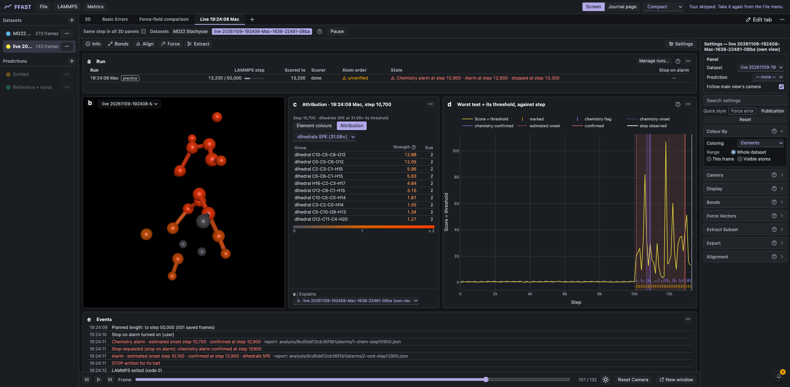

# DetectAna

[](https://github.com/AntonCh-G/DetectAna/actions/workflows/ci.yml)
[](LICENSE)
[](https://www.python.org/)

DetectAna finds the frame where an MD or PIMD trajectory leaves the region its
machine-learned force field was trained on. A force field drifting out of its
training data keeps returning plausible forces, so nothing crashes. DetectAna
scores every frame against the training data and reports when the run left it,
at a false-alarm rate you set in advance.

That frame is where to cut the run, and the structures around it are the ones
worth recomputing and adding to the training set. A flag means *outside the
training data*, not *chemically impossible*.



*DetectAna running inside [FFAST](https://github.com/TCPUniLU/FFAST) during a
LAMMPS run (in development). Plot **d** shows the highest score ÷ threshold per
step; above 1 means the frame is marked. Panel **c** lists the dihedrals with
the highest attribution strength for the alarm. The run stopped on a chemistry
alarm.*

## Install

```bash
git clone https://github.com/AntonCh-G/DetectAna.git
cd DetectAna
pip install -e ".[pipeline]"     # batch pipeline, scripts, plots
# pip install -e .               # library only: fit, save, load, score
# pip install -e ".[dev]"        # + tests, ruff, mypy
```

Python 3.10–3.12, CPU only. The force field stays outside DetectAna.

## Use

**Batch, after the run.** Try the demo, then copy the template for your data:

```bash
python scripts/run_pipeline.py --config config/demo.yaml     # seconds; writes outputs/demo/
cp config/example.yaml config/local.yaml                     # fill in your paths
python scripts/run_pipeline.py --config config/local.yaml
```

You need an `initial.xyz` defining the molecule, the force field's
`train`/`valid` reference frames, and the trajectory in one of these forms:
i-PI XYZ (one file per bead plus a centroid), one HDF5 file, or, for classical
MD, one file in any format ASE reads (`.traj`, extxyz, ...). You get per-frame
scores, an onset table (first bead, persistent bead, centroid and collective
onset), chemistry flags, the atoms behind each alarm, plots and a `manifest.json`
recording every parameter.

**Library, frame by frame.**

```python
import detectana
from detectana.topology import build_topology

bundle = detectana.fit(train, valid, build_topology("initial.xyz"))  # (frames, atoms, 3), Å
bundle.save("aspirin.bundle")

bundle = detectana.load("aspirin.bundle")
marked = bundle.exceedance(bundle.score(frames), role="bead").marked
why = bundle.attribute(frames, "dihedrals", score="SPE")             # which atoms
```

## How it works

1. **Descriptor**: bond lengths, angles, dihedrals (as sin, cos) and ring
   planarity, taken from the molecule in `initial.xyz`. The atom order is
   checked on every frame.
2. **Four tracks** (bonds, angles, dihedrals, ring), each fitted on training
   frames only and scored twice. **T²** asks whether a frame is unusual among
   the motions seen in training. **SPE** asks whether it shows a new kind of
   motion.
3. **Thresholds** come from held-out validation frames. The false-alarm rate is
   split across the tests.
4. **Onset** is a window rule, not the first flagged frame. You state the
   false-alarm chance you accept for the whole run.
5. **Beads are kept apart.** A single bead can leave the training data before
   the centroid does, so bead, centroid and run onsets are reported separately.
6. **Chemistry checks** (broken bonds, close contacts) and **attribution** to
   atoms are reported separately from the score.

Equations and reasoning are in [docs/methodology.md](docs/methodology.md).

## Status and limits

Version 0.4.0, in development. The four-track default is provisional until it
is benchmarked on real data. Benchmark results are withheld until the
associated work is published; the code to reproduce them is here. Whether a
high score predicts force-field error is not yet tested.

The input must be one gas-phase molecule with a fixed atom order. Periodic
boxes are not unwrapped. Only positions are used, not forces.

## Documentation

- [Usage](docs/usage.md): every config key, script and output
- [Methodology](docs/methodology.md): the method, with equations
- [Reproducibility](docs/reproducibility.md): data, environment, determinism
- [Scientific rules](docs/scientific-rules.md): read before changing anything
- [Glossary](docs/glossary.md), [decision records](docs/adr/), [changelog](CHANGELOG.md)

## License and citation

MIT, see [LICENSE](LICENSE). Citation metadata is in [CITATION.cff](CITATION.cff).
The screenshot is from [FFAST](https://github.com/TCPUniLU/FFAST) (MIT).
